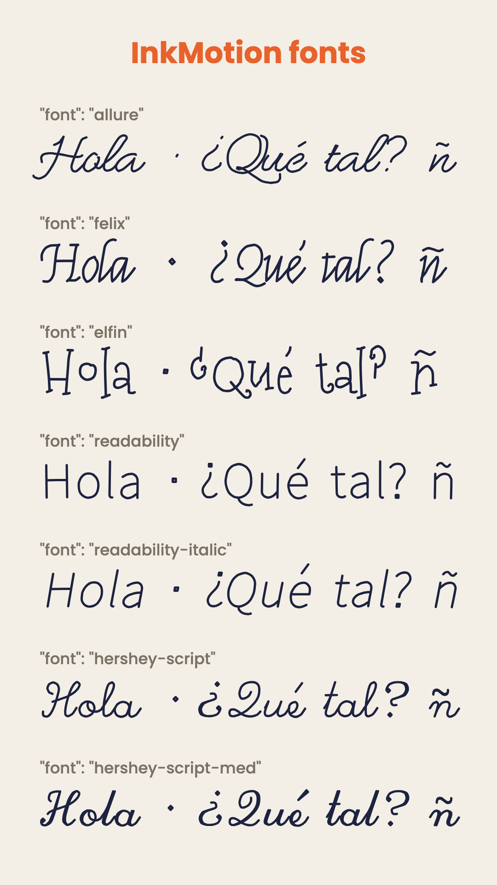

# ✍️ InkMotion

**Handwriting and hand-drawn motion graphics for [Claude Code](https://claude.com/claude-code). After Effects-style animation without After Effects.**

Describe the animation in a JSON file, or ask Claude for it in plain words. InkMotion writes your text **stroke by stroke with real pen fonts**, draws underlines, circles and arrows by hand, makes neon signs glow, inks your line art, and renders it all with [Remotion](https://remotion.dev). You get an MP4, an MP4 over your own footage, or a **transparent overlay** for Premiere, After Effects or DaVinci.


*[Español abajo ↓](#español)*

## Why not just use an AI video model?

Generative video models misspell text and change it from frame to frame. InkMotion draws vector strokes, so every letter is exact, accents included, and the timing is controlled to the frame. It can follow a voiceover word by word.

## Features

- **Handwriting**: 7 single-line pen fonts (cursive, calligraphic, playful, monoline print) with full Spanish/Latin-1 coverage: á é í ó ú ñ ¿ ¡ €
- **Natural pen timing**: strokes accelerate and decelerate, the pen lifts between letters, connected cursive flows without pauses, and each letter wobbles slightly
- **Doodles**: underline, double underline, circle, box, arrow, check, cross, star, heart, sparkle, marker highlight, scribble, free path
- **Neon and glow**, drop shadows, a glowing **pen tip** that leads the stroke
- **SVG draw-on**: any icon, logo or line art traces its outlines, then fills in ("Trim Paths + fill")
- **Kinetic titles** with regular fonts: rise, pop, blur, typewriter, wipe, by char, word or line
- **Exits**: fade, **erase** (the writing runs backwards), wipe
- After Effects easing curves: `outExpo`, `outBack`, `outElastic`, `outBounce`, …
- **Backgrounds**: colour, image, **your video** (with its audio), or transparent ProRes 4444
- Relative timing (`"+0.3"`, `"@title+0.5"`), a timeline printout, stills and contact sheets for fast checking



## Install (Claude Code)

Paste this into Claude Code:

> Install the InkMotion skill from `https://github.com/galuxstudio/inkmotion` into `~/.claude/skills/inkmotion`, run `npm install` inside it, and render `examples/hello.json` to check that it works.

Or by hand:

```bash
git clone https://github.com/galuxstudio/inkmotion ~/.claude/skills/inkmotion
cd ~/.claude/skills/inkmotion && npm install
node scripts/render.mjs examples/hello.json out/hello.mp4 --sheet
```

Requirements: **Node.js 18+** and **ffmpeg** (`brew install ffmpeg`). Optional: `uv` or Python 3.12 with `vtracer`, to turn drawings into SVG.

## Use it

Talk to Claude:

> *"Write 'Happy Hour' in pink neon handwriting over my clip bar.mp4, circle the margarita at second 3, and give me a transparent version for Premiere."*

Or write a spec yourself:

```json
{
  "width": 1080, "height": 1920,
  "background": { "type": "color", "color": "#f4efe6" },
  "layers": [
    { "id": "title", "type": "write", "text": "Hola, mundo", "font": "allure",
      "y": "36%", "size": 190, "color": "#1d2340", "start": 0.4 },
    { "type": "doodle", "shape": "underline", "y": "41%", "w": 560, "color": "#e8622c", "start": "+0.1" },
    { "type": "text", "text": "¡Sin After Effects!", "animation": "pop", "y": "60%", "start": "@title+1" }
  ]
}
```

```bash
node scripts/render.mjs scene.json out/scene.mp4 --sheet     # MP4 + contact sheet
node scripts/render.mjs scene.json out/scene.mov --alpha     # transparent ProRes 4444
node scripts/render.mjs scene.json out/frame.png --still=2.5 # one frame
node scripts/render.mjs scene.json x.mp4 --timeline          # when each layer starts/ends
npm run studio                                               # live preview in Remotion Studio
```

The full spec reference is in [SKILL.md](SKILL.md). Examples are in [`examples/`](examples).

## Drawings made with AI

Generate black-ink line art with any image model, vectorise it, and InkMotion draws it:

```bash
uv run --python 3.12 --with vtracer --with pillow python scripts/vectorize.py art.png art.svg
```

---

## Español

**Animaciones de escritura a mano y motion graphics dibujados, estilo After Effects, para Claude Code.**

Describe la animación en un JSON, o simplemente pídesela a Claude. InkMotion escribe tu texto **trazo por trazo con fuentes de pluma reales**, dibuja subrayados, círculos y flechas a mano, hace letreros de neón, entinta tus ilustraciones y lo renderiza con Remotion. Obtienes un MP4, un MP4 encima de tu propio video, o un **overlay transparente** para Premiere, After Effects o DaVinci.

**¿Por qué no un modelo de video con IA?** Escriben mal las palabras y las deforman cuadro a cuadro. InkMotion dibuja trazos vectoriales: la ortografía siempre es exacta (acentos, ñ, ¿¡ incluidos) y el tiempo se controla al cuadro, incluso sincronizado palabra por palabra con una voz en off.

**Instalación:** pega esto en Claude Code:

> Instala la skill InkMotion desde `https://github.com/galuxstudio/inkmotion` en `~/.claude/skills/inkmotion`, corre `npm install` adentro y renderiza `examples/hello.json` para comprobar que funciona.

Requisitos: **Node.js 18+** y **ffmpeg**.

**Ejemplo de pedido:**

> *"Escribe 'Happy Hour' a mano en neón rosa encima de mi clip bar.mp4, enciérrame la margarita en un círculo en el segundo 3 y dame una versión transparente para Premiere."*

Qué incluye: 7 fuentes de pluma, doodles (subrayado, círculo, flecha, palomita, estrella, corazón, marcador…), neón con punta de pluma brillante, SVG que se dibuja solo y luego se rellena, títulos animados (rise, pop, blur, máquina de escribir, wipe), salidas (desvanecer, **borrar en reversa**, barrido), curvas de easing de After Effects, fondo de color, imagen, tu video o transparente.

---

## Licence / Licencia

- InkMotion code: **MIT** (see [LICENSE](LICENSE)).
- Fonts: SIL Open Font License 1.1 (EMS fonts) and the Hershey font licence. Credits are in [NOTICE.md](NOTICE.md).
- Rendering uses **Remotion**, which has its own licence: free (commercial use included) for individuals, non-profits and companies with up to 3 employees; larger companies need a [Remotion company licence](https://remotion.dev/license). / Remotion es gratis para personas, organizaciones sin fines de lucro y empresas de hasta 3 empleados; empresas más grandes necesitan licencia.
